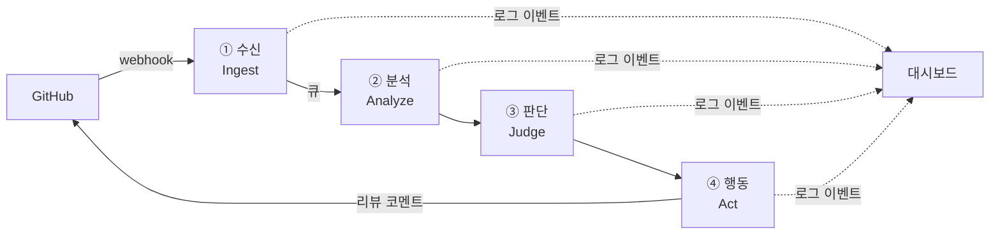

# CO-DAY

GitHub Pull Request를 자동으로 분석해 리뷰 코멘트를 남기는 AI 코드 리뷰 에이전트와, 그 처리 과정을 실시간으로 보여 주는 대시보드입니다.

🔗 서비스 주소: https://co-day.me (준비 중)

## 주요 기능

- **자동 코드 리뷰**: PR이 열리거나 업데이트되면 변경 사항을 분석해 버그, 스타일, 보안 이슈를 리뷰 코멘트로 등록합니다.
- **실시간 처리 현황**: 에이전트가 각 단계를 처리하는 과정을 대시보드에서 실시간으로 확인할 수 있습니다.
- **리뷰 히스토리**: 지금까지의 리뷰 결과와 이슈를 목록과 diff 화면으로 확인할 수 있습니다.
- **보완 영역 분석**: 이슈 유형별 통계를 차트로 보여 줍니다.
- **레포지토리 관리**: 리뷰를 적용할 레포지토리를 켜고 끌 수 있습니다.

## 동작 방식

PR 이벤트가 들어오면 4단계 파이프라인을 거쳐 리뷰가 등록됩니다.



| 단계 | 역할 |
| --- | --- |
| ① 수신 (Ingest) | 웹훅 수신, 서명 검증, 중복 이벤트 처리, 큐 적재 |
| ② 분석 (Analyze) | PR diff 수집, 파싱, 파일 필터링, 청크 분할, 컨텍스트 수집 |
| ③ 판단 (Judge) | LLM 기반 코드 분석, 구조화된 출력, 이슈 분류 (버그 / 스타일 / 보안) |
| ④ 행동 (Act) | PR 리뷰 코멘트 등록, 결과 저장, 단계별 로그 이벤트 발행 |

각 단계의 결과는 저장되며, 중간에 실패하면 실패한 단계부터 다시 실행합니다.

## 기술 스택

| 영역 | 기술 |
| --- | --- |
| 백엔드 | Python 3.12, FastAPI, Pydantic v2 |
| 에이전트 | OpenAI Agents SDK |
| GitHub 연동 | GitHub App |
| 비동기 처리 | PostgreSQL 기반 큐 |
| 실시간 | SSE, PostgreSQL LISTEN/NOTIFY |
| DB | PostgreSQL 16, SQLAlchemy 2.0, Alembic |
| 프론트엔드 | React, TypeScript, Vite, TanStack Query, Tailwind CSS, shadcn/ui |
| 코드 품질 | ruff, pyright, import-linter, pytest |
| 인프라 | Docker Compose, Caddy, AWS EC2, GitHub Actions |
| 모노레포 | uv workspace, pnpm |

## 폴더 구조

```
co-day/
├── apps/
│   ├── web/          # 대시보드 (React)
│   ├── api/          # API 서버 (웹훅 수신, 대시보드 API, SSE)
│   └── worker/       # 파이프라인 실행 워커
├── packages/
│   ├── contracts/    # 모듈 간 데이터 계약 (Pydantic 스키마)
│   ├── core/         # 공통 인프라 (DB, 큐, 이벤트, GitHub 클라이언트)
│   └── pipeline/     # 파이프라인 4단계 모듈
│       ├── ingest/
│       ├── analyze/
│       ├── judge/
│       └── act/
├── fixtures/         # 테스트용 PR 샘플 데이터
├── scripts/          # 개발·배포 보조 스크립트
├── docs/             # 설계 문서
└── infra/            # Docker, 배포 설정
```

### 설계 원칙

- 파이프라인 모듈은 서로 직접 참조하지 않고, `contracts`에 정의된 스키마로만 데이터를 주고받습니다.
- 모듈 연결은 `apps/worker`에서만 이루어집니다.
- 모든 모듈은 같은 형태(`service.py` 진입 함수 + `tests/`)를 따릅니다.

## 시작하기

### 사전 준비

- Python 3.12
- [uv](https://docs.astral.sh/uv/)
- Node.js 20, [pnpm](https://pnpm.io/)
- Docker, Docker Compose

### 설치

```bash
git clone https://github.com/<owner>/co-day.git
cd co-day

# Python 의존성
uv sync

# 프론트엔드 의존성
cd apps/web
pnpm install
```

### 환경 변수

```bash
cp .env.example .env
```

`.env`에 GitHub App 정보, OpenAI API 키 등을 입력합니다. 각 항목의 설명은 `.env.example`을 참고하세요.

> ⚠️ `.env`와 GitHub App private key(`.pem`)는 절대 커밋하지 마세요.

### 실행

```bash
# 로컬 개발 환경 (준비 중)
docker compose up
```

## 테스트

```bash
uv run pytest
```